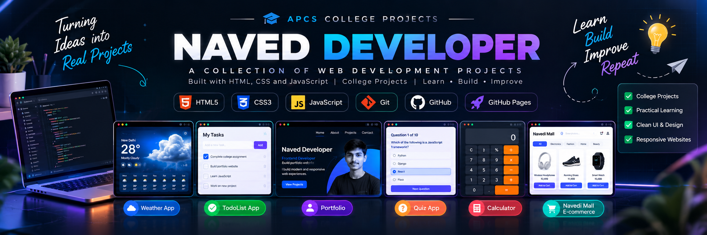
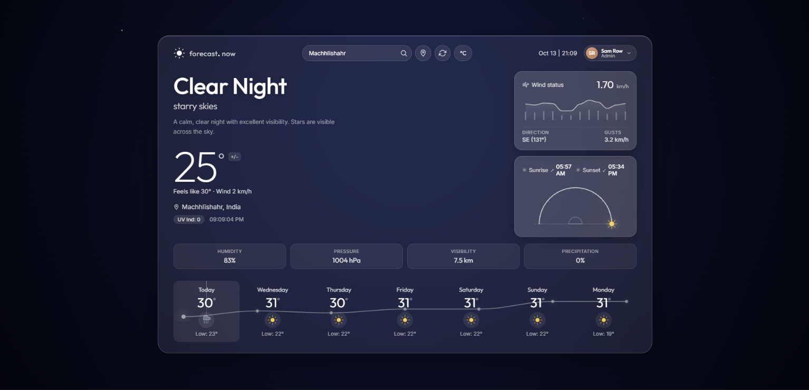
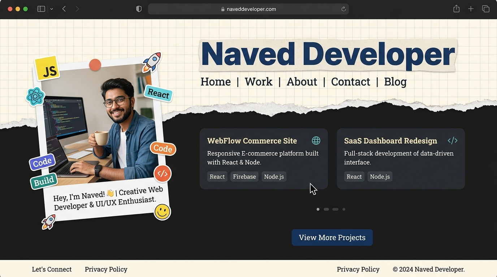
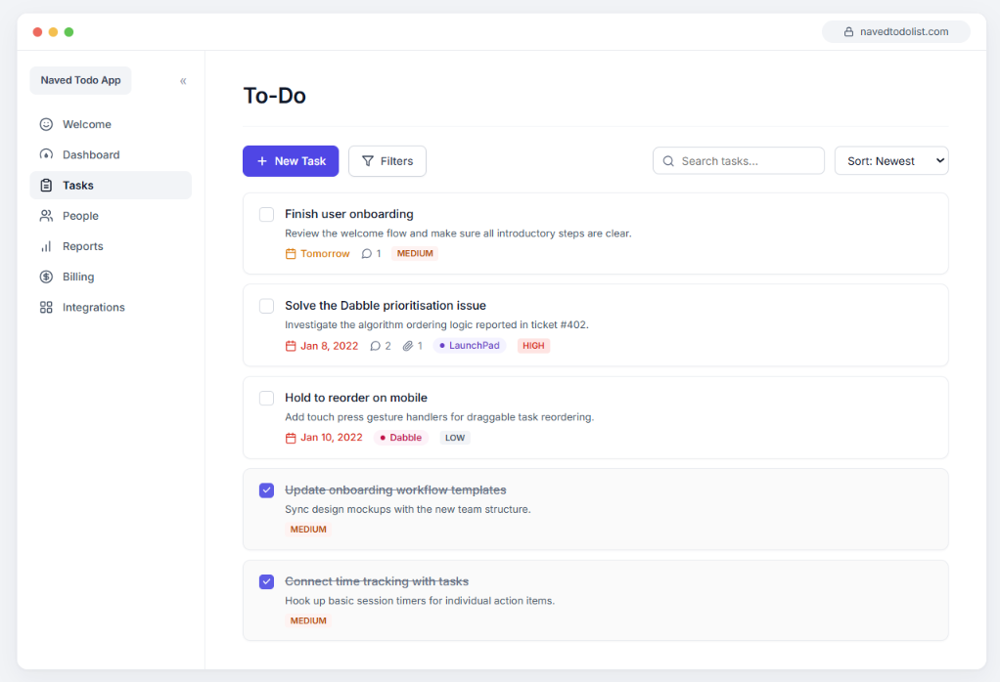
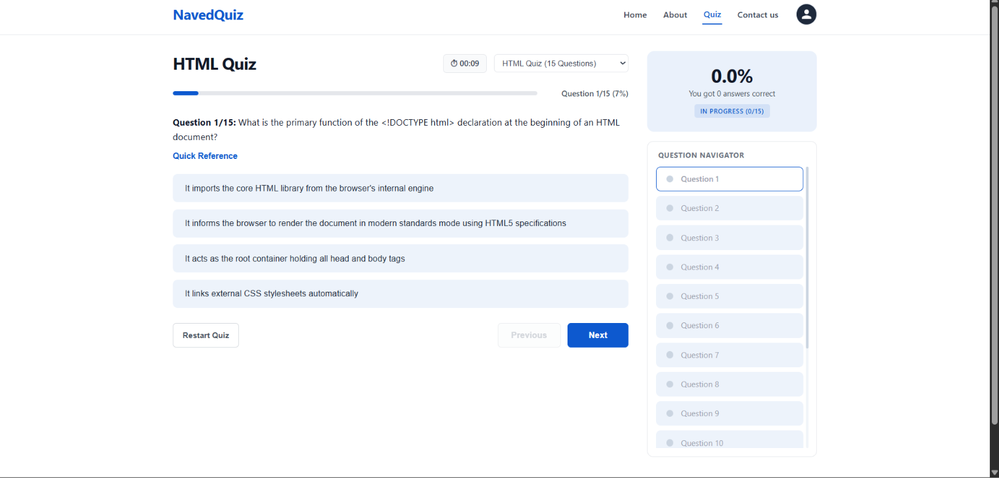

# 🚀 APCS College Projects

<p align="center">
  
</p>

<h1 align="center">APCS College Projects</h1>

<p align="center">
  A collection of interactive web development projects built with HTML, CSS, and JavaScript as part of my college coursework.
</p>

<p align="center">
  
  
  
  
  
</p>

<p align="center">
  <b>Learn • Build • Improve</b>
</p>

---

## 📌 About This Repository

This repository contains six web development projects created for my APCS college coursework. Each project focuses on practical frontend development concepts, including responsive layouts, user interactions, application logic, and clean UI design.

The main portfolio website brings all projects together so visitors can explore them from one place.

## 🌐 Explore My Projects

### 1. 🌦️ Weather App

<p align="center">
  
</p>

A weather application designed to display weather conditions and forecast information through a simple, user-friendly interface.

**Features**

- Weather information display
- Search and user input, where implemented
- Weather API integration, where configured
- Responsive interface

**Technologies:** HTML, CSS, JavaScript

- **Project folder:** [`Weather/`](Weather/)
- **Live Demo:** [Open Weather App](Weather/)

---

### 2. 👨‍💻 Personal Portfolio

<p align="center">
  
</p>

A personal portfolio website showcasing my introduction, skills, education, selected projects, and contact information.

**Features**

- Personal introduction
- Project showcase with links
- Education and skills sections
- Responsive navigation
- Links to project demonstrations

**Technologies:** HTML, CSS, JavaScript

- **Project folder:** Root directory
- **Live Demo:** [Open Portfolio](./)

---

### 3. ✅ TodoList App

<p align="center">
  
</p>

A task management application designed to help users organize daily activities and track task completion.

**Features**

- Add and manage tasks
- Mark tasks as completed
- Track task status
- Interactive task list
- Responsive layout

**Technologies:** HTML, CSS, JavaScript

- **Project folder:** [`TodoList/`](TodoList/)
- **Live Demo:** [Open TodoList](TodoList/)

---

### 4. 🧠 NavedQuiz

<p align="center">
  
</p>

An interactive quiz application for practising web development knowledge through multiple-choice questions.

**Features**

- Multiple-choice questions
- Answer selection
- Question navigation
- Quiz progress tracking
- Score calculation and results, where implemented

**Technologies:** HTML, CSS, JavaScript

- **Project folder:** [`Quiz/`](Quiz/)
- **Live Demo:** [Open Quiz App](Quiz/)

---

### 5. 🧮 Calculator

<p align="center">
  
</p>

A calculator application with an interactive interface for performing basic arithmetic operations.

**Features**

- Number and operator buttons
- Addition, subtraction, multiplication, and division
- Clear and delete operations, where implemented
- Decimal number support, where implemented
- Responsive calculator layout

**Technologies:** HTML, CSS, JavaScript

- **Project folder:** [`Calculator/`](Calculator/)
- **Live Demo:** [Open Calculator](Calculator/)

---

### 6. 🛍️ Navedi Mall E-commerce

<p align="center">
  
</p>

An e-commerce website project featuring a product-focused interface and a shopping experience.

**Features**

- Product display
- Product browsing interface
- Shopping UI
- Responsive layout
- Interactive elements, where implemented

**Technologies:** HTML, CSS, JavaScript

- **Project folder:** [`Ecommerse/`](Ecommerse/)
- **Live Demo:** [Open Navedi Mall](Ecommerse/)

---

## 🖼️ Project Gallery

<p align="center">
  
  
  
</p>

<p align="center">
  
  
  
</p>

## 🛠️ Technologies Used

| Technology   | Purpose                                             |
| ------------ | --------------------------------------------------- |
| HTML5        | Page structure and content                          |
| CSS3         | Styling, layouts, animations, and responsive design |
| JavaScript   | Interactivity and application logic                 |
| Git          | Version control                                     |
| GitHub       | Source code hosting                                 |
| GitHub Pages | Hosting static websites                             |

## 📂 Repository Structure

```text
apcs-college-projects/
│
├── index.html
├── style.css
├── script.js
├── README.md
├── .gitignore
├── LEARNINGS.txt
├── projects.txt
│
├── assets/
│   ├── banner.png
│   ├── weather.png
│   ├── portfolio.png
│   ├── todolist.png
│   ├── quiz.png
│   ├── calculator.png
│   └── ecommerce.png
│
├── Weather/
│   ├── index.html
│   ├── style.css
│   └── script.js
│
├── TodoList/
│   ├── index.html
│   ├── style.css
│   └── script.js
│
├── Quiz/
│   ├── index.html
│   ├── style.css
│   └── script.js
│
├── Calculator/
│   ├── index.html
│   ├── style.css
│   └── script.js
│
└── Ecommerse/
    ├── index.html
    ├── style.css
    └── script.js
```

_This structure illustrates the expected organization. Keep the actual filenames and folders consistent with your repository._

## 🚀 Run Locally

1. Clone or download the repository.
2. Open the project folder in Visual Studio Code.
3. Open the root `index.html` to view the portfolio.
4. Open any project's folder and run its `index.html`.
5. For local testing, use the Live Server extension in Visual Studio Code.

## 🌍 Deploy with GitHub Pages

1. Push the repository to GitHub.
2. Open **Settings → Pages** in your repository.
3. Under **Build and deployment**, select **Deploy from a branch**.
4. Select the `main` branch and `/(root)` folder.
5. Click **Save** and wait for publishing to finish.
6. Open your published portfolio and test each project link.

### Live Website Links

Replace `naveddeveloper` and `apcs-` with your actual GitHub username and repository name.

| Project     | URL                                                          |
| ----------- | ------------------------------------------------------------ |
| Portfolio   | `https://naveddeveloper.github.io/apcs-projects/`            |
| Weather App | `https://naveddeveloper.github.io/apcs-projects/Weather/`    |
| TodoList    | `https://naveddeveloper.github.io/apcs-projects/TodoList/`   |
| NavedQuiz   | `https://naveddeveloper.github.io/apcs-projects/Quiz/`       |
| Calculator  | `https://naveddeveloper.github.io/apcs-projects/Calculator/` |
| Navedi Mall | `https://naveddeveloper.github.io/apcs-projects/Ecommerse/`  |

These are URL templates, not verified live deployments. The links will work once GitHub Pages is enabled and each folder contains its own `index.html`.

## 🎯 What I Learned

Through these projects, I am practising:

- Writing structured HTML.
- Styling interfaces with CSS.
- Making websites interactive with JavaScript.
- Handling button clicks, events, and DOM manipulation.
- Building responsive layouts for different screen sizes.
- Working with APIs where required.
- Organizing website files and assets.
- Debugging and testing frontend applications.
- Managing code with Git and GitHub.
- Deploying static websites with GitHub Pages.

## 🔮 Future Improvements

- Improve accessibility and responsive design.
- Refine user experience and animations.
- Improve error handling and input validation.
- Add more useful features to existing projects.
- Continue learning modern web development practices.

## 👨‍🎓 About Me

**Naved Ansari — Naved Developer**

I am pursuing a **Bachelor of Computer Applications (BCA)** and currently studying in the **2nd year, 3rd semester**.

These projects represent my learning journey in frontend web development and my effort to turn classroom concepts into practical applications.

- **GitHub:** https://github.com/naveddeveloper
- **Portfolio:** https://naveddeveloper.github.io/apcs-projects/

---

<p align="center">
  <b>Built with ❤️ as part of my APCS college coursework.</b>
</p>
